<p align="center">
  
</p>

<h1 align="center">Harish Code</h1>

<p align="center">
  <strong>The open source AI coding agent — Harish Code edition.</strong><br/>
  A desktop coding agent for Windows, rebuilt and rebranded by
  <a href="https://github.com/harishpixous-commits">@harishpixous-commits</a>.
</p>

<p align="center">
  <a href="https://github.com/harishpixous-commits/Harishcode">Repository</a> ·
  <a href="https://github.com/harishpixous-commits">Author</a> ·
  <a href="docs/BRANDING.md">Branding guide</a> ·
  <a href="docs/CHANGELOG.md">Changelog</a>
</p>

---

## What is Harish Code?

Harish Code is a **rebranded distribution** of the open source [OpenCode](https://github.com/anomalyco/opencode)
desktop coding agent. The application logic is unchanged; the identity, artwork,
colour usage, copy and About page are Harish Code's.

It runs entirely on your machine and works with the free model providers that
ship with the app, plus Ollama and any OpenAI-compatible endpoint you configure.

## Features

- **Sessions** — persistent chat history per project, with search and drafts
- **Free models** — Beam Free, Flint 40B Free, DeepSeek V4.1 Flash Free,
  GLM-5.3-Flash Free, MiMo-V2.6-Flash Free, Nemotron 3.5 and more
- **Local models** — first-class Ollama support
- **Providers** — OpenAI, Anthropic, Google, GitHub Copilot and any
  OpenAI-compatible base URL
- **Projects & worktrees** — per-repository context, git worktree aware
- **Pairing** — connect another device to your own local server
- **Theming** — light, dark, system, plus custom UI/code/terminal fonts

## Install (Windows)

The packaged application is distributed as a Windows build:

```
Harish Code/
├── Harish Code.exe
└── resources/
    ├── app.asar
    ├── opencode-cli.exe
    └── ...
```

Run `Harish Code.exe`. On first launch the app starts a local server
(`127.0.0.1`) and writes its profile to `%APPDATA%`.

> The compiled runtime lives in [`app/`](app). `app.asar` is not committed —
> it is produced from `app/` with the packer in [`build/`](build).

## Repository layout

| Path | Purpose |
| --- | --- |
| [`app/`](app) | Patched application runtime — `out/`, `resources/`, `package.json` |
| [`assets/`](assets) | Harish Code logo marks, lockups and favicons |
| [`build/`](build) | Tooling to repack `app.asar` reproducibly |
| [`docs/`](docs) | Branding notes and changelog |

## Building

```bash
# 1. install runtime deps (not committed)
cd app && npm install

# 2. repack the application archive
node ../build/asar-tool.js pack /path/to/original/app.asar app ../dist/app.asar

# 3. drop dist/app.asar into an Electron shell's resources/ directory
```

The `build/` scripts are the exact ones used to produce the shipped build, so a
rebuild is reproducible from this repository plus a base Electron shell.

## Branding

All artwork is derived from the HC monogram. See [`docs/BRANDING.md`](docs/BRANDING.md)
for the colour values, type rules and the full asset list.

| Asset | Size | Use |
| --- | --- | --- |
| `logo-lockup.png` | 1164×200 | README / splash lockup |
| `logo-tile-1024.png` | 1024² | Store / app tile |
| `logo-mark-256.png` | 256² | App icon base |
| `logo-mark-32.png` | 32² | Small tray/taskbar |
| `favicon-512.png` | 512² | Window / web favicon |

In-app marks are drawn inline as SVG in `currentColor` so they follow the
light/dark theme automatically.

## License

MIT — see [LICENSE](LICENSE).

Harish Code is an independent rebrand. It is **not** affiliated with or endorsed
by Anomaly Innovations, Inc. The upstream MIT notice is retained as the licence
requires; see [NOTICE](NOTICE) for the full attribution chain.
